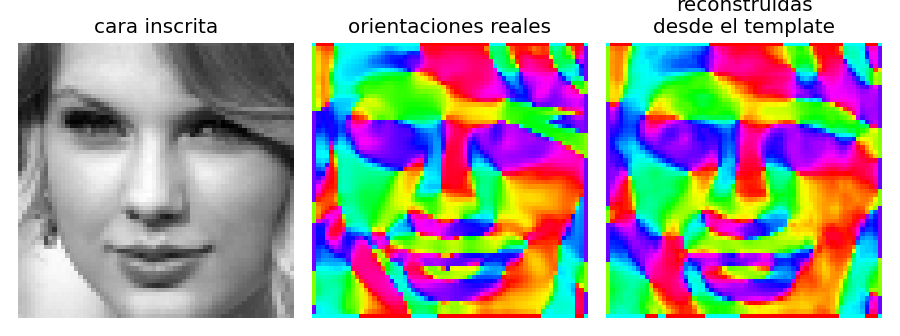
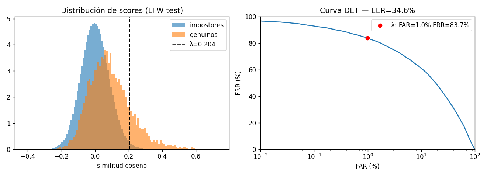
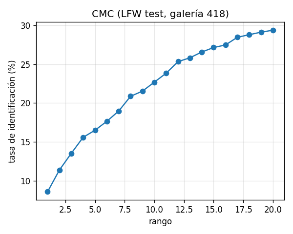
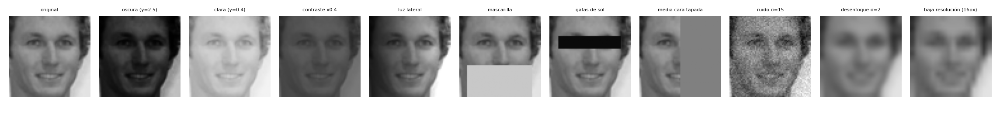
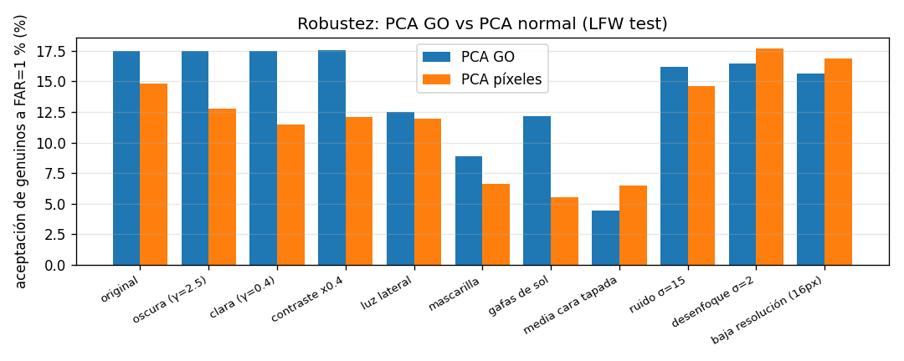

# Reconocimiento facial con PCA GO

Práctica de Sistemas Biométricos (UMA). Es un sistema de reconocimiento facial en Python que usa **PCA GO** (PCA sobre la orientación de los gradientes de la imagen, también llamado IGO-PCA). Detecta la cara con YuNet y guarda las plantillas (templates) de las personas inscritas en un CSV cifrado con AES-256-GCM. Tiene los 9 métodos que pide el enunciado, scripts para evaluarlo y una batería de ataques.

El sistema lo va a probar otro grupo para intentar romperlo. Por eso el apartado más importante de este README es el [9, Limitaciones conocidas](#9-limitaciones-conocidas): ahí está todo lo que sabemos que falla. Si el otro grupo encuentra algo que no está ahí, es un fallo nuestro.

## Índice

1. [Puesta en marcha](#1-puesta-en-marcha)
2. [Cómo se usa](#2-cómo-se-usa)
3. [Cómo funciona por dentro](#3-cómo-funciona-por-dentro)
4. [Qué hace cada fichero](#4-qué-hace-cada-fichero)
5. [Decisiones de diseño](#5-decisiones-de-diseño)
6. [Seguridad](#6-seguridad)
7. [Evaluación y resultados](#7-evaluación-y-resultados)
8. [Cómo probar el sistema](#8-cómo-probar-el-sistema)
9. [Limitaciones conocidas](#9-limitaciones-conocidas)
10. [Reentrenar el modelo](#10-reentrenar-el-modelo)
11. [Problemas típicos](#11-problemas-típicos)
12. [Pendiente](#12-pendiente)
13. [Referencias](#13-referencias)

---

## 1. Puesta en marcha

El repositorio ya trae el modelo entrenado en `models/`, así que **no hace falta descargar LFW** para usar el sistema. LFW solo se necesita para reentrenar o reevaluar (apartado 10).

### Con Python (3.10 o superior)

En Linux o Mac:

```bash
python -m venv .venv
source .venv/bin/activate
pip install -r requirements.txt
```

En Windows (PowerShell):

```powershell
py -m venv .venv
.venv\Scripts\activate
pip install -r requirements.txt
```

Después, para crear la clave y la base de datos con las fotos de `data/`:

```bash
python -m facerec init
python -m facerec listar
```

`init` genera la clave de cifrado en `secrets/db.key`, inscribe las 50 fotos de `data/` y deja la base de datos en `db/templates.csv`. Esas dos carpetas (`db/` y `secrets/`) no se suben a git: cada persona que instale el sistema genera las suyas.

Una prueba rápida:

```bash
python -m facerec verificar taylor_swift_2009 data/taylor_swift_2009.jpg
python -m facerec identificar data/adele_2016.jpg
```

### Con Docker

```bash
mkdir -p db secrets fotos
docker compose build
docker compose run --rm facerec init
docker compose run --rm facerec identificar /fotos/una_foto.jpg
```

Las fotos que quieras probar tienen que estar en `./fotos`. El `Dockerfile` está escrito, pero no hemos podido construir la imagen (ver [Pendiente](#12-pendiente)).

### Dónde está la clave

El sistema busca la clave de la base de datos en este orden:

1. la variable de entorno `FACEREC_DB_KEY` (32 bytes en base64);
2. el fichero que indique `FACEREC_DB_KEY_FILE`;
3. `secrets/db.key`, que es el que crea `init`.

Para usar otra base de datos distinta de `db/templates.csv` se pasa `--db ruta.csv` o se define `FACEREC_DB_PATH` (esto también vale para `init`).

### Variables de entorno

| Variable | Para qué sirve |
|---|---|
| `FACEREC_DB_KEY` | Clave de cifrado en base64 |
| `FACEREC_DB_KEY_FILE` | Fichero que contiene la clave |
| `FACEREC_DB_PATH` | Ruta de la base de datos |
| `FACEREC_ADMIN_TOKEN` | Contraseña de administrador. Sin ella, `borrar` está deshabilitado |
| `FACEREC_RATE_LIMIT` | Rechazos permitidos por minuto (por defecto 30). Con `0` se desactiva el límite |

En PowerShell las variables se definen así: `$env:FACEREC_RATE_LIMIT = "0"`.

### Si vais a probar el sistema con muchas llamadas

El sistema cuenta los rechazos de `verificar*` e `identificar*` y, al llegar a 30 en un minuto sobre el mismo id (o 30 en `identificar`), responde `RateLimitError` hasta que pase ese minuto. Está pensado para frenar los ataques de fuerza bruta. Si vais a lanzar miles de comparaciones para evaluar el sistema, desactivad el límite con `FACEREC_RATE_LIMIT=0`. Los scripts de `scripts/` ya lo hacen por su cuenta.

---

## 2. Cómo se usa

### Desde Python

```python
from facerec import SistemaBiometrico
s = SistemaBiometrico()          # la BD tiene que existir (la crea `init`)

s.inscribir("ana", "ana.jpg")    # foto -> detector -> extractor -> BD
s.verificar("ana", "ana2.jpg")   # True / False
s.identificar("ana2.jpg")        # "ana" o None (desconocido)

s.inscribir_sd("ana", "cara.jpg")   # sin detector: la foto ya es la cara
s.verificar_sd("ana", "cara.jpg")
s.identificar_sd("cara.jpg")

t = s.extraer("ana.jpg")         # el template: 150 números
s.inscribir_t("ana", t)          # sin detector ni extractor
s.verificar_t("ana", t)
s.identificar_t(t)
```

Para crear una base de datos vacía desde código se usa `SistemaBiometrico(crear_bd=True)`. Sin eso, si la BD no existe da error (es a propósito, ver [6](#6-seguridad)).

La foto puede ser una ruta, unos `bytes` o un array de numpy (BGR o gris). El template puede ser un array, una lista o un texto `"v1,v2,...,v150"`.

### Desde la terminal

```bash
python -m facerec inscribir    <id> <foto>
python -m facerec verificar    <id> <foto>
python -m facerec identificar  <foto>
python -m facerec inscribir_sd <id> <foto>      # y verificar_sd, identificar_sd
python -m facerec inscribir_t  <id> <template>  # y verificar_t, identificar_t
python -m facerec extraer [--sd] <foto> [--out t.npy]
python -m facerec borrar <id> --token <token>
python -m facerec listar
```

Un `<template>` puede ser un `.npy`, un `.csv` o `.txt` con valores separados por comas, o los valores escritos directamente.

La salida es un JSON por pantalla. El código de salida es 0 si se acepta o todo va bien, 1 si se rechaza o la persona es desconocida, y 2 si hay un error. **La terminal nunca imprime el score**, solo sí/no o el id (explicado en [6](#6-seguridad)).

Para borrar a alguien hace falta definir antes la variable `FACEREC_ADMIN_TOKEN` y pasar el mismo valor con `--token`:

```bash
FACEREC_ADMIN_TOKEN=xxx python -m facerec borrar ana --token xxx
```

### Los 9 métodos

| Variante | Inscribir | Verificar | Identificar |
|---|---|---|---|
| Completa (detector + extractor) | `inscribir(id, foto)` | `verificar(id, foto)` | `identificar(foto)` |
| Sin detector | `inscribir_sd(id, foto)` | `verificar_sd(id, foto)` | `identificar_sd(foto)` |
| Con template | `inscribir_t(id, template)` | `verificar_t(id, template)` | `identificar_t(template)` |

Además hay `extraer(foto)` y `extraer_sd(foto)` (devuelven el template), `borrar(id, token)` y `inscritos()`.

### Qué hace el sistema en cada situación

| Situación | Qué pasa |
|---|---|
| `verificar` | Devuelve `True` si la similitud coseno con el template inscrito es **≥ λ = 0,2035** |
| `identificar` | Es **identificación abierta**: devuelve el id más parecido solo si su similitud es **≥ λ_id = 0,3313**; si no, devuelve `None` |
| Inscribir un id que ya existe | Da error. Primero hay que borrarlo, y borrar necesita el token de administrador |
| `verificar` con un id que no existe | Devuelve `False`, igual que un rechazo (aunque el id sí se puede descubrir de otras formas, ver D21) |
| Foto sin cara | Error `FaceError` |
| Foto con varias caras | Se usa la de mayor área, salvo que la segunda tenga al menos el 50 % de su área: entonces es ambigua y da `FaceError` |
| Template `_t` que se parece a demasiados ids a la vez | `verificar_t` lo rechaza (defensa "lobo", explicada en [6](#6-seguridad)) |
| Muchos rechazos seguidos | `RateLimitError` hasta que acabe la ventana de 60 s |
| Dos procesos escribiendo a la vez | Se ponen en cola con un bloqueo de fichero, no se pierde ninguna inscripción |
| Template `_t` con longitud distinta de 150, NaN, infinitos, valores de más de 1000 o vector nulo | Error `TemplateError` |
| Id con caracteres raros | Error. Se admiten de 1 a 64 caracteres entre letras, números, espacio y `_ - ( ) . '`, empezando por letra o número, sin salto de línea |
| BD manipulada, clave incorrecta, CSV vacío o borrado | Error `DBIntegrityError`. El sistema no funciona hasta que se arregle (*fail closed*). Solo `init` crea una BD nueva |
| Imagen que declara más de 8000 px de lado | Error `FaceError`, antes de decodificarla |

---

## 3. Cómo funciona por dentro

### La idea de PCA GO

PCA normal trabaja con el brillo de los píxeles. PCA GO trabaja con la **dirección de los bordes**. Esa dirección casi no cambia si la foto está más clara o más oscura, y en las zonas tapadas o planas el ruido tiende a cancelarse. Por eso aguanta mejor los cambios de luz que las *eigenfaces*.

### El recorrido de una foto

```
foto
 └─ YuNet: detecta la cara y 5 puntos (ojos, nariz, boca)
     └─ alineación: se gira y escala para que los ojos queden en posiciones fijas
         └─ recorte de 64×64 en gris
             └─ blur gaussiano (σ = 1,2) y filtro Sobel 3×3 -> gradiente (Gx, Gy)
                 └─ ángulo φ = atan2(Gy, Gx) de cada píxel
                     └─ vector con [cos φ, sin φ] de cada píxel (8.192 números)
                         └─ PCA con 150 componentes y whitening
                             └─ template: 150 números
                                 └─ similitud coseno contra los templates de la BD
```

Detalles que conviene saber:

- Se usan el coseno y el seno del ángulo, y no el ángulo, para que 1° y 359° queden cerca.
- El PCA se entrena una sola vez con **4.065 caras de LFW** (personas con una única foto) pasadas por nuestro mismo pipeline. Se guarda en `models/pca_igo.npz` y **no se reentrena al inscribir a alguien**.
- El whitening divide cada componente por la raíz de su autovalor, para que todas pesen igual en el coseno. Mejora el EER en unos 2 puntos.
- Para decidir, se compara el score con un umbral: λ para verificar y λ_id para identificar.

### La ruta sin detector (`_sd`)

Los métodos `_sd` se saltan YuNet. La imagen se pasa a gris y se redimensiona a 64×64 **sin alinear ni recortar**, así que se espera que la foto ya sea la cara. Se rechaza cualquier imagen de menos de 32 px por lado. Como no hay alineación, esta ruta reconoce peor (ver [7](#7-evaluación-y-resultados)).

### La ruta con template (`_t`)

Los métodos `_t` se saltan el detector y el extractor y trabajan directamente con los 150 números. Antes de usarlos se comprueba que el vector tiene la longitud correcta, que no tiene NaN ni infinitos, que ningún valor pasa de 1000 en valor absoluto y que no es el vector cero.

### La base de datos

Es un CSV con tres columnas, `id,nonce,data`:

```
id,nonce,data
adele_2016,<nonce en base64>,<template cifrado en base64>
...
__manifest__,<nonce en base64>,<resumen cifrado de todas las filas>
```

- Cada template (150 floats) se cifra con AES-256-GCM. El id va como dato asociado, así que si alguien mueve un template a otro id, el descifrado falla.
- La última fila (`__manifest__`) autentica el conjunto de filas completo. Gracias a ella se detectan filas borradas, añadidas o duplicadas.
- Los ids se ven en claro. Los templates no.
- Si el CSV no existe o está vacío, el sistema da error en vez de tratarlo como una BD vacía. Si lo tratara como vacía, alguien sin la clave podría borrar el fichero y volver a inscribir a una víctima con su propia cara.

---

## 4. Qué hace cada fichero

### `facerec/` (el sistema)

| Fichero | Qué hace |
|---|---|
| `__init__.py` | Exporta la clase `SistemaBiometrico` y los errores. Fija el límite de píxeles de OpenCV antes de importarlo |
| `__main__.py` | La terminal (`python -m facerec ...`) |
| `config.py` | Todos los parámetros en un único sitio: tamaños, umbrales del detector, nombres de variables de entorno, límites |
| `detector.py` | Carga de imágenes (con comprobación de tamaño y respaldo de Pillow), el detector YuNet, la regla de varias caras, la alineación por los ojos y el recorte de `_sd` |
| `igo.py` | El extractor: vector de gradientes, PCA (entrenar, proyectar, reconstruir) y coseno |
| `db.py` | La base de datos cifrada: clave, cifrado por fila, manifiesto, comprobación de ids |
| `filelock.py` | Bloqueo de fichero (`.lock`) para que dos procesos no pisen la BD a la vez |
| `ratelimit.py` | Límite de intentos fallidos, guardado en `<bd>.ratelimit.json` |
| `system.py` | La clase `SistemaBiometrico`: los 9 métodos, `borrar`, `inscritos`, la defensa "lobo" |
| `metrics.py` | FAR, FRR, EER, curvas DET y CMC para la evaluación |

### `scripts/` (evaluación y pruebas)

| Script | Qué hace |
|---|---|
| `prepare_lfw.py` | Pasa LFW por el detector y la alineación y crea los splits (train, calib, test, overlap, twin) |
| `experiments.py` | Compara tamaños, número de componentes, whitening y blur (resultados en `docs/experiments.json`) |
| `train.py` | Entrena el PCA definitivo y calibra λ y λ_id |
| `evaluate.py` | La evaluación completa (bloques A a E) y las figuras de `docs/figs/` |
| `attacks.py` | La batería de ataques. Trabaja siempre sobre una copia de la BD |
| `pruebas_extra.py` | Pruebas sin LFW: fotos reales de `data/`, robustez, regresiones de seguridad y concurrencia |
| `probar_fotos.py` | Prueba el sistema con vuestras fotos (Mamdani, impresas, en pantalla, varias caras) |
| `generar_pruebas.py` | Genera variantes **simuladas** a partir de `data/` (luz, giro, gafas, mascarilla, pantalla, papel, dos caras) |

### Resto

| Carpeta o fichero | Contenido |
|---|---|
| `models/` | YuNet (`.onnx`), el PCA (`pca_igo.npz`) y los umbrales (`threshold.json`) |
| `data/` | Las fotos de inscripción: 49 del profesor y la de Mamdani |
| `docs/` | Resultados en JSON y figuras |
| `tests/test_system.py` | 39 tests con pytest |
| `tests/*_simulada/` | Fotos simuladas, cada carpeta con su `LEEME.txt` |
| `Dockerfile`, `docker-compose.yml` | Para ejecutarlo en contenedor |
| `requirements.txt`, `requirements-dev.txt` | Dependencias (la segunda añade matplotlib y pytest) |

---

## 5. Decisiones de diseño

| Tema | Elección | Motivo |
|---|---|---|
| Detector | YuNet (viene en OpenCV) | No añade dependencias pesadas, da 5 puntos para alinear y detectó todas las caras del dataset y de LFW |
| Confianza mínima | 0,7 | Todas las caras del dataset dan 0,86 o más. Así se descartan detecciones dudosas |
| Varias caras | Se usa la mayor; si hay otra con el 50 % o más de su área, error | `adam_pearson_2024` tiene 3 caras pero la suya domina (la segunda mide el 21 %). Elegir en silencio entre dos caras parecidas sería comparar a la persona equivocada |
| Alineación | Por los dos ojos, a posiciones fijas | PCA GO compara dónde están los bordes, así que sin alinear falla |
| Tamaño de cara | 64×64, de cejas a barbilla | Con 32, 48, 64 y 80 los resultados son casi iguales |
| Preproceso | Blur σ = 1,2 y Sobel 3×3 | En zonas planas el ángulo es aleatorio y el blur lo calma. Baja el EER del 36,7 % al 35,3 % |
| Datos de entrenamiento | LFW, personas con una sola foto (4.065) | Con las 50 fotos del profesor solo saldrían 49 componentes y se sobreajustaría |
| Famosos repetidos | Se excluyen del entrenamiento y la calibración las 9 personas que están en LFW y en el dataset, más 3 gemelos o hermanos | Si no, las métricas salen infladas. Se usan aparte como pruebas reales |
| Componentes | k = 150 | Mejor EER junto con k entre 100 y 200 |
| Distancia | Similitud coseno | Los vectores IGO tienen norma constante y la comparación teórica de IGO es una correlación |
| Umbral de verificar (λ) | 0,2035, calibrado en LFW para FAR = 1 % | Es un sistema de seguridad: se prefiere no dejar pasar impostores |
| Umbral de identificar (λ_id) | 0,3313, calibrado para FPIR = 1 % con 51 personas | Con λ, el 39 % de los desconocidos acabaría identificado como alguien, porque el FAR se acumula al comparar contra toda la galería |
| Tipo de identificación | Abierta (puede responder "desconocido") | La cerrada siempre devuelve a alguien y es trivial de explotar |
| Id repetido | Error. Borrar exige token de administrador | Si se pudiera sobrescribir, o borrar sin protección, cualquiera suplantaría a otra persona reinscribiéndose con su id |
| Qué devuelve la terminal | Solo sí/no o el id, nunca el score | Con el score, un ataque de *hill-climbing* entra en unas 19 consultas |
| Formato de la BD | CSV (`id,nonce,data`) | Lo exige el enunciado |
| Clave | Fuera del repo y de la imagen Docker | Si la clave está al lado del CSV, cifrar no sirve de nada |
| Persona 51 | Zohran Mamdani | Elección del grupo |
| Docker | `python:3.12-slim` con `opencv-python-headless` | Imagen ligera, sin compilar nada |

---

## 6. Seguridad

### Qué suponemos del atacante

- Conoce todo el código y el modelo PCA, porque el repositorio es público para el grupo rival.
- Puede leer el CSV y, en el peor caso, escribirlo. También se estudia el caso de que robe la clave.
- Puede llamar a cualquiera de los 9 métodos, incluidos `_sd` y `_t`, saltándose así el detector y el extractor.

### Defensas que tiene el sistema

- **BD cifrada y autenticada** (AES-256-GCM por fila, id como dato asociado, manifiesto). Leerla sin la clave no da ningún template, y cualquier cambio se detecta.
- **Falla cerrado.** Con un CSV manipulado, vacío, borrado o con otra clave, el sistema no opera.
- **Borrar protegido.** Sin `FACEREC_ADMIN_TOKEN` no se puede borrar. La comparación del token es en tiempo constante.
- **Ids validados** con una expresión regular completa (`fullmatch`), para que no cuele un salto de línea final, ni `=1+1`, ni `../x`, ni `__manifest__`.
- **Imágenes sospechosas.** Se lee la cabecera antes de decodificar, para rechazar imágenes que declaran un tamaño enorme (bombas de descompresión). Tope de 20 MB y 8000 px por lado.
- **Defensa "lobo".** Un template fabricado que se parece a muchos ids a la vez no es una cara. Si un template supera λ contra más de max(8, 15 % de los inscritos) ids, `verificar` lo rechaza. En las 50 fotos, un template legítimo supera λ contra 5 ids como mucho (incluido el suyo). La media de la BD supera λ contra 19, y un template optimizado contra la BD, contra 31.
- **Límite de intentos.** 30 rechazos por minuto por id, y 30 en `identificar`. Guardado en disco, así que no se esquiva reiniciando el programa.
- **Bloqueo de fichero.** Evita que dos inscripciones simultáneas se pisen. Antes de este parche, 6 inscripciones a la vez dejaban solo 2 a 4 en la BD, sin dar ningún error.
- **Fotos ambiguas.** Dos caras de tamaño parecido se rechazan.
- **Modelo cargado desde memoria.** Se comprueba el hash de YuNet y se lee en bytes (OpenCV no abre rutas con tildes en Windows).
- **La terminal no enseña scores.**

### Ataques probados (`python scripts/attacks.py`)

Se ejecutan siempre sobre una copia de la BD. Resultados completos en `docs/results_attacks.json`.

**Leer la base de datos**

- Sin la clave: se ven los 50 ids en claro y bloques cifrados. No se obtiene ningún template.
- Con la clave robada: se descifran los 50 templates y, con el PCA del repo, se reconstruye el mapa de bordes de cada cara (coseno medio de 0,88 con el real). Ver la figura:



**Escribir en la base de datos sin la clave**

Se detectan todos estos: cambiar un bit, intercambiar templates entre dos ids, renombrar un id, borrar una fila, duplicar una fila, añadir una fila inventada, vaciar campos, dejar solo la cabecera, vaciar o borrar el CSV para inscribir a la víctima de nuevo, y `borrar` sin token.

No se detecta:

- **Rollback.** Si se restaura una copia antigua y completa del CSV, el sistema no se entera. Una persona dada de baja vuelve a estar inscrita.
- **Con la clave robada**, poner el template del atacante bajo el id de la víctima. Con la clave, el atacante puede hacer cualquier cosa.

**Saltarse partes del sistema**

| Ataque | Resultado |
|---|---|
| `_t` con el template filtrado de la víctima | Se acepta. Es lo esperable: el template es la credencial |
| `_t` con ceros, NaN, infinitos, longitud mala, 1e9 o texto | Se rechaza |
| `_t` con el template medio de la BD | Supera λ contra 19 de 50 ids, pero la defensa lobo lo rechaza en los 50. `identificar_t` devuelve `None` |
| `_t` con un template optimizado contra toda la BD | Supera λ contra 31 ids, pero la defensa lobo lo rechaza en los 50. Si el atacante optimiza contra 8 ids o menos a la vez, sí pasa (D17) |
| `_t` con fuerza bruta (200.000 templates aleatorios, sin límite) | 1.177 aciertos contra un id concreto (0,59 %, unos 170 intentos por acierto). Con el límite por defecto, tras 30 intentos recibe `RateLimitError` |
| `_t` con *hill-climbing* teniendo el score | Entra en unas 19 consultas. Por eso la terminal no da el score |
| `identificar_sd` con imágenes que no son caras (gris, negro, ruido, degradado, tablero) | Ninguna se identifica |
| `_sd` con una imagen de 10×10 | Se rechaza |
| PNG de 100 a 250 KB que declara 9000×9000 o 16000×16000 | Se rechaza leyendo la cabecera |
| Foto con dos caras del mismo tamaño (víctima y atacante) | Se rechaza por ambigua |
| Reinscribir un id existente con otra cara | Se rechaza |
| Ids maliciosos | Se rechazan |

---

## 7. Evaluación y resultados

Se ejecuta con `python scripts/evaluate.py`. Resultados completos en `docs/results_eval.json` y figuras en `docs/figs/`.

### Experimentos para elegir parámetros

El EER en `calib` (más bajo es mejor) se movió siempre entre el 34,9 % y el 39 %. Las diferencias entre configuraciones son de 1 o 2 puntos. El techo lo pone el método (PCA, lineal y sin supervisión), no los parámetros. Se eligió 64×64, k = 150, whitening y σ = 1,2, que queda a menos de medio punto del mejor resultado.

Sin whitening todo empeora unos 2 puntos. Las eigenfaces (PCA de píxeles, la referencia) dan 40,3 % sin whitening y 37,0 % con él, así que PCA GO es mejor pero por poco en fotos sin alterar. Los datos completos están en `docs/experiments.json`.

### A. LFW test (836 personas que el sistema nunca vio)



| Métrica | Valor |
|---|---|
| Pares genuinos / impostores | 7.195 / 5.159.310 |
| EER | 34,6 % |
| Con λ: FAR / FRR | 1,0 % / 83,7 % |
| Identificación cerrada (galería de 418): rank-1 / rank-5 / rank-10 | 8,6 % / 16,5 % / 22,7 % |
| Identificación abierta con λ_id: correctos / "desconocido" / FPIR | 3,6 % / 88,2 % / 7,8 % |

El FPIR sale por encima del 1 % porque λ_id está calibrado para 51 personas y aquí la galería es de 418.



Las distribuciones de genuinos e impostores se solapan mucho. Con FAR del 1 % se rechaza a 5 de cada 6 genuinos. Es lo esperable: las eigenfaces rondan el 60 % de acierto en LFW, que tiene pose, expresión y luz libres y poca resolución.

### B. El sistema real (50 inscritos)

Genuinos: 120 fotos de LFW de 9 personas inscritas, comparadas contra su foto de inscripción.

| Persona | Fotos | Acepta `verificar` | Rank-1 | `identificar` correcto |
|---|---:|---:|---:|---:|
| serenna_williams_2017 | 52 | 9,6 % | 13,5 % | 0 % |
| elisabeth_II_1945 | 13 | 0 % | 7,7 % | 0 % |
| jackie_chan_2000 | 13 | 0 % | 0 % | 0 % |
| salma_hayek_2012 | 13 | 7,7 % | 7,7 % | 0 % |
| keanu_reeves_2021 | 12 | 8,3 % | 8,3 % | 0 % |
| michael_jackson_1982 | 12 | 0 % | 0 % | 0 % |
| mary-kate_olsen_2011 | 3 | 0 % | 0 % | 0 % |
| christian_bale_2012 | 1 | 0 % | 0 % | 0 % |
| james_phelps_(gemelo_weasley)_2011 | 1 | 0 % | 0 % | 0 % |
| **Total** | **120** | **5,8 %** | **8,3 %** | **0 %** |

Impostores: 4.911 fotos de personas no inscritas. El FAR de `verificar` por comparación es del 0,88 %, y el FPIR de `identificar` con λ_id es del 0,67 % (con λ sería del 33,8 %).

Impostores con las propias fotos del profesor (50×49 pares, `pruebas_extra.py`): el FAR con λ sale alrededor del **2,5 %** (varía unas décimas según la máquina), no el 1 % calibrado en LFW. **37 de los 50 ids aceptan al menos a un impostor.** Ningún par supera λ_id. Esto pasa porque las fotos del profesor son de mejor calidad que las de LFW y los scores no están en la misma escala.

El sistema casi nunca deja pasar a un impostor en LFW, pero tampoco reconoce bien a los genuinos cuando la foto es distinta de la de inscripción. Lo peor son las diferencias grandes de edad (Isabel II en 1945, Michael Jackson en 1982).

### C. Gemelos y hermanos

| Foto | Contra quién | Resultado |
|---|---|---|
| Ashley Olsen | mary-kate_olsen_2011 | Rechazada (score −0,03, puesto 29) |
| Oliver Phelps | james_phelps_(gemelo_weasley)_2011 | Rechazado (score 0,04, puesto 15) |
| Venus Williams (17 fotos) | serenna_williams_2017 | Todas rechazadas, pero en 2 fotos Serena sale la más parecida |

Se rechazan porque el umbral es muy estricto y rechaza casi todo, no porque el sistema distinga gemelos. Con un umbral más permisivo, Venus se identificaría como Serena en el 12 % de sus fotos.

### D. Robustez: PCA GO frente a PCA de píxeles

Aceptación de genuinos con FAR = 1 % (LFW test, galería de 836 y 1.609 fotos de prueba alteradas a propósito).




| Alteración | PCA GO | PCA píxeles |
|---|---:|---:|
| Original | 17,5 % | 14,8 % |
| Oscura (γ = 2,5) | 17,5 % | 12,8 % |
| Clara (γ = 0,4) | 17,5 % | 11,5 % |
| Contraste ×0,4 | 17,5 % | 12,1 % |
| Luz lateral | 12,5 % | 11,9 % |
| Mascarilla | 8,9 % | 6,7 % |
| Gafas de sol | 12,2 % | 5,5 % |
| Media cara tapada | 4,4 % | 6,5 % |
| Ruido σ = 15 | 16,2 % | 14,6 % |
| Desenfoque σ = 2 | 16,5 % | 17,7 % |
| Baja resolución (16 px) | 15,7 % | 16,9 % |

PCA GO no se mueve con los cambios globales de brillo y contraste, aguanta mejor las gafas de sol y algo mejor la mascarilla. Con luz lateral pierde 5 puntos, y con media cara tapada, desenfoque o poca resolución es peor que PCA de píxeles, porque se pierden bordes.

### E. Ruta `_sd`

Con las 120 fotos genuinas, con detector se acepta el 5,8 %. Pasando a `verificar_sd` el recorte del detector sin alinear, el 2,5 %. La alineación importa. Una imagen gris uniforme saca 0,171 contra `adam_pearson_2024`, bastante cerca de λ = 0,2035.

### F. Robustez sobre las 50 fotos de inscripción (`pruebas_extra.py`)

Probando cada foto de `data/` contra su propio template tras alterarla. Sobre 50:

| Alteración | Sin cara | Verificar OK | Identificar OK | Identificar mal |
|---|---:|---:|---:|---:|
| Original | 0 | 50 | 50 | 0 |
| Espejo horizontal | 0 | 19 | 13 | 1 |
| Rotación +5° | 0 | 50 | 50 | 0 |
| Rotación −10° | 0 | 49 | 46 | 0 |
| Rotación +20° | 0 | 36 | 25 | 0 |
| Rotación 45° | 5 | 1 | 0 | 1 |
| Escala 0,5 | 0 | 44 | 38 | 0 |
| Escala 0,25 | 0 | 42 | 30 | 3 |
| Escala 0,1 | 5 | 25 | 15 | 1 |
| JPEG calidad 10 | 0 | 49 | 49 | 0 |
| Ruido σ = 15 | 0 | 49 | 49 | 0 |
| Ruido σ = 40 | 19 | 15 | 15 | 0 |
| Oscura (γ = 2,5) | 0 | 49 | 47 | 0 |
| Clara (γ = 0,4) | 0 | 50 | 50 | 0 |
| Media cara negra | 11 | 5 | 4 | 1 |

"Identificar mal" quiere decir que devolvió a **otra persona** (no "desconocido"). Es lo más grave de la tabla.

---

## 8. Cómo probar el sistema

### Lo básico

```bash
python -m pytest -q                  # 39 tests, unos 5-15 segundos
python scripts/pruebas_extra.py      # fotos reales, robustez, seguridad y concurrencia
```

`pruebas_extra.py` se puede lanzar por bloques con `--solo reales`, `--solo robustez`, `--solo seguridad` o `--solo concurrencia`. No necesita LFW. Si todo va bien, todas las líneas de seguridad salen con `[OK]`.

Qué comprueban los tests (en `tests/test_system.py`):

- los 9 métodos y el flujo normal de inscribir, verificar e identificar;
- que no se puede sobrescribir un id y que `borrar` exige el token;
- ids inválidos, templates inválidos, foto sin cara;
- BD cifrada, manipulada, con clave incorrecta, vacía o borrada;
- bomba de descompresión, respaldo de Pillow, todas las fotos de `data/` se cargan;
- defensa lobo, límite de intentos (con y sin límite), bloqueo huérfano;
- inscripciones simultáneas con hilos;
- dos caras de tamaño parecido y una cara dominante.

### La batería de ataques

```bash
python scripts/attacks.py
```

Si queréis evaluar el sistema de otro grupo, la batería se puede reutilizar cambiando las llamadas a `SistemaBiometrico`.

### Probar con vuestras fotos

```bash
python scripts/probar_fotos.py --id zohran-mamdani tests/mamdani
python scripts/probar_fotos.py tests/presentacion
python scripts/probar_fotos.py --id taylor_swift_2009 foto1.jpg foto2.jpg
```

Por defecto usa una base de datos temporal con las fotos de `data/` y no toca `db/` ni `secrets/`. Con `--real` usa vuestra BD de verdad (hay que haber hecho `init`).

Para saber qué persona se espera en cada foto, mira por este orden: el `--id` si lo hay, el texto antes de `__` en el nombre del fichero (`taylor_swift_2009__pantalla1.jpg` espera `taylor_swift_2009`), o el nombre del fichero o carpeta si coincide con un inscrito.

Por cada foto da si se detecta la cara, el score contra su id, la posición en el ranking, el resultado de `verificar` y de `identificar`, y al final un resumen por persona.

### Fotos simuladas

`python scripts/generar_pruebas.py` crea tres carpetas a partir de las fotos de `data/`:

- `tests/mamdani_simulada/`: 12 variantes de Mamdani (más oscura, más clara, luz lateral, desenfocada, con ruido, girada, espejo, gafas de sol, mascarilla...).
- `tests/presentacion_simulada/`: cinco personas, cada una "fotografiada" en pantalla y en papel impreso.
- `tests/varias_caras_simulada/`: tres fotos con dos caras.

**Son simulaciones, no sustituyen a fotos reales.** Cada carpeta lleva un `LEEME.txt` que lo dice. Resultados con ellas:

- Mamdani: 10 de 12 aceptadas. Fallan el espejo (score 0,05) y las gafas de sol (−0,07). La mascarilla pasa, pero con score bajo (0,46).
- Pantalla e impresa: las 10 se verifican (puesto 1). Dos impresas, Idris Elba y Lady Gaga, salen como "desconocido" en `identificar` porque quedan por debajo de λ_id.
- Dos caras iguales: error por ambigua. Una cara claramente mayor que la otra: se procesa y acierta.

### Fotos reales (pendiente de hacer)

Lo que más falta son estas tres cosas, hechas con fotos de verdad:

1. 5 a 10 fotos de Mamdani en `tests/mamdani/`, variadas (luz, gafas, edad, expresión).
2. Fotos hechas con el móvil a una foto impresa y a una pantalla, de 3 a 5 inscritos, en `tests/presentacion/`, con nombres como `idpersona__impresa1.jpg` e `idpersona__pantalla1.jpg`.
3. Una o dos fotos reales con dos personas, en `tests/varias_caras/`.

Estas carpetas no deben ir a `data/` (eso cambiaría la BD), y conviene no subirlas al repositorio: añadidlas al `.gitignore`.

---

## 9. Limitaciones conocidas

Esta es la lista de lo que sabemos que falla o que no cubrimos. Los números D son fijos para que se puedan citar.

### Reconocimiento

- **D1. Precisión baja con fotos reales.** EER del 34,6 % en LFW. Con λ se rechaza al 84 % de los genuinos, y en el sistema real solo se acepta el 5,8 % de las fotos genuinas distintas de la de inscripción. Es un límite de PCA GO (lineal y sin supervisión), no un fallo del código. Con fotos controladas (frontales y con buena luz) funciona mejor.
- **D2. Edad.** Con diferencias grandes (Isabel II en 1945, Michael Jackson en 1982) el acierto es del 0 %.
- **D3. Pose.** Con la cara girada o de perfil, los bordes cambian de sitio y falla.
- **D4. Expresión fuerte** (boca abierta, ojos cerrados): mueve los bordes igual que la pose.
- **D5. Depende de la alineación.** Si YuNet coloca mal los ojos, falla. Por `_sd`, que no alinea, el acierto baja del 5,8 % al 2,5 %.
- **D6. Oclusiones grandes.** Con media cara tapada, PCA GO es peor que PCA de píxeles (4,4 % frente a 6,5 %). La mascarilla lo baja a la mitad.
- **D7. Luz lateral fuerte.** Las sombras crean bordes nuevos y el acierto baja del 17,5 % al 12,5 %. Solo es invariante a cambios globales de luz.
- **D8. Desenfoque y poca resolución.** Se pierden los bordes, y ahí PCA de píxeles es igual o mejor.
- **D9. Gemelos y hermanos.** No los distingue. Venus Williams sale como la persona más parecida a Serena en 2 de 17 fotos. Solo se rechaza porque el umbral es muy estricto.
- **D10. "Lobos" entre los inscritos.** Algunos inscritos atraen más falsos positivos que otros. Con λ_id, `aitana_etxebarria_(twin_melody)_2024` y `christian_bale_2012`. Con λ, `christian_bale_2012`, `leticia_sabater_1996` y `keanu_reeves_2021`.
- **D11. Una sola foto de inscripción.** El template depende de esa foto concreta (luz, expresión, edad).
- **D12. Posible sesgo demográfico.** El PCA se entrenó con LFW, que tiene sobre todo hombres, piel clara y políticos de EE. UU. de los años 2000. No lo hemos medido.
- **D33. Identificación errónea.** Con la foto a escala 0,25, `identificar` devuelve otra persona en 3 de 50 casos (Adele → Zoe Saldana, Josie Totah → Santiago Segura, Mary-Kate Olsen → Ariana Grande). Con una foto reflejada (como la de la cámara frontal), Willem Dafoe sale como Idris Elba, y además solo 19 de 50 se verifican bien.

### Detector y presentación

- **D13. Sin detección de vida.** Una foto impresa o en una pantalla funciona como la persona real. Con las fotos simuladas se verifican las 10. Falta probarlo con fotos reales hechas con una cámara.
- **D14. Varias caras.** Gana la más grande, salvo que haya otra con el 50 % o más de su área (entonces error). Con una cara claramente dominante, quien la ponga más grande decide con quién se compara. Medido con composiciones: 400/400 px es ambigua, 700/200 px usa la grande.
- **D15. `_sd` acepta cualquier imagen como si fuera una cara.** Solo exige un mínimo de 32 px.

### Interfaz `_t`

- **D16. Fuerza bruta con templates aleatorios.** Pasa el 0,59 % de los intentos contra un id concreto. Está **mitigado, no resuelto**: el límite de 30 rechazos por minuto lo pasa de segundos a horas. El límite se desactiva con `FACEREC_RATE_LIMIT=0`, y quien pueda escribir en `db/` puede borrar `<bd>.ratelimit.json`.
- **D17. Template medio o optimizado.** La defensa lobo los rechaza (tope de 8 ids), pero un atacante con la BD descifrada puede optimizar un template contra 8 ids o menos a la vez, y ese pasa. Con imágenes sin cara por `_sd` el score se queda cerca de λ (0,17 frente a 0,20).
- **D18. Hill-climbing.** La terminal no da el score, pero la librería sí (`puntuar()` y `ranking()` existen para evaluar). Cualquiera que la importe puede hacer hill-climbing y entrar en unas 19 consultas.
- **D19. Un template robado es una credencial.** Quien tenga un template válido pasa `verificar_t`. No se puede revocar, porque la cara es la misma.

### Base de datos y ficheros

- **D20. Rollback.** Restaurar una copia antigua completa del CSV no se detecta. Haría falta un contador que suba siempre, guardado fuera del CSV.
- **D21. Los ids se ven en claro y se puede saber si existen.** Leer el CSV revela quién está inscrito. Además `inscribir` ("ya inscrito"), `borrar` y `listar` revelan si un id existe.
- **D22. Robo de la clave = control total.** Permite descifrar, reconstruir el mapa de bordes de cada cara y meter templates propios. La clave está en `secrets/db.key`, en la misma máquina que la BD.
- **D23. Modelos sin firmar.** `models/threshold.json` y `models/pca_igo.npz` no están firmados. Quien pueda escribir en `models/` puede poner por ejemplo `"lambda": -1` y aceptar a todo el mundo. El hash del PCA se comprueba contra `threshold.json`, pero ese fichero también se puede cambiar.
- **D24. Bloqueo de fichero.** Funciona entre procesos que usen este código. Si un proceso muere con el bloqueo puesto, caduca a los 60 s. Quien edite el CSV a mano se salta el bloqueo.
- **D25. Decodificación de imágenes no confiables.** Se usa OpenCV, y sus vulnerabilidades serían las nuestras. Hay límite de 20 MB y 8000 px, y se comprueba la cabecera de PNG, JPEG y BMP. WEBP solo queda protegido por la variable `OPENCV_IO_MAX_IMAGE_PIXELS`.
- **D28. El token de administrador.** Quien controle el entorno donde corre el sistema puede definir `FACEREC_ADMIN_TOKEN`. Solo protege contra quien llama a la librería o a la terminal sin el token.
- **D29. `_sd` con fotos completas.** Redimensiona toda la imagen a 64×64 sin recortar. Una foto entera (sin recortar a la cara) da un template distinto al de `inscribir`. Falta definir qué recorte esperamos en `_sd`.
- **D30. Rutas con tildes en Windows.** OpenCV no abre ficheros si la ruta tiene tildes o `º`. Por eso YuNet se carga desde memoria. Para las fotos, mejor trabajar en una ruta sin acentos (`C:\proyectos`).
- **D31. Fotos con extensión engañosa.** `aitana_etxebarria_(twin_melody)_2024.jpg` es en realidad AVIF y `falete_2018.jpg` es WEBP. OpenCV puede no abrirlas, así que `load_image` usa Pillow de respaldo. Sin Pillow, `init` falla en esas fotos y queda en 48 o 49 inscritos.
- **D32. Denegación de servicio por el límite de intentos.** Quien provoque 30 rechazos seguidos contra un id lo bloquea para su dueño durante 60 s.

### Umbrales

- **D26. Seguridad frente a usabilidad.** λ y λ_id son muy estrictos. Con λ_id, `identificar` no reconoce a ningún genuino del sistema real (0 %). Bajarlos dispara los falsos positivos: con λ en `identificar`, 1 de cada 3 desconocidos se identifica como alguien.
- **D27. Umbrales calibrados en LFW.** Las fotos del profesor son de mejor calidad, así que los scores no tienen la misma escala. Medido: el FAR con λ es de alrededor del 2,5 % entre las 50 fotos del profesor, no el 1 % buscado.

---

## 10. Reentrenar el modelo

Solo hace falta si queréis cambiar parámetros o rehacer la evaluación.

```bash
pip install -r requirements-dev.txt

# 0. Descargar LFW (unos 230 MB). Necesita scikit-learn
python -c "from sklearn.datasets import fetch_lfw_people; fetch_lfw_people()"

# 1. Pasar LFW por el detector y la alineación, y crear los splits (~1 min)
python scripts/prepare_lfw.py --lfw ~/scikit_learn_data/lfw_home/lfw_funneled

# 2. Experimentos de parámetros (~4 min)
python scripts/experiments.py

# 3. Entrenar el PCA definitivo y calibrar λ y λ_id
python scripts/train.py

# 4. Rehacer la BD
python -m facerec init --force

# 5. Evaluación y ataques
python scripts/evaluate.py --lfw ~/scikit_learn_data/lfw_home/lfw_funneled
python scripts/attacks.py
```

Los splits de LFW se hacen por persona, para que nadie aparezca en dos:

| Split | Fotos | Personas | Para qué |
|---|---:|---:|---|
| `train` | 4.065 | 4.065 | Entrenar el PCA (personas con una sola foto) |
| `calib` | 4.118 | 836 | Elegir parámetros y calibrar λ y λ_id |
| `test` | 4.911 | 836 | Solo la evaluación final. Nunca se usó para decidir nada |
| `overlap` | 120 | 9 | Famosos que también están inscritos |
| `twin` | 19 | 3 | Ashley Olsen, Oliver Phelps y Venus Williams |

En `calib` y `test` hay como mucho 10 fotos por persona, para que George W. Bush (530 fotos) no domine.

---

## 11. Problemas típicos

**`DBIntegrityError` al arrancar.** La BD no existe, está vacía, la manipularon o la clave no es la que la cifró. Si es una instalación nueva, hay que ejecutar `python -m facerec init`.

**`RateLimitError`.** Demasiados rechazos seguidos. Esperad un minuto o poned `FACEREC_RATE_LIMIT=0`.

**`borrar` dice que está deshabilitado.** Falta definir `FACEREC_ADMIN_TOKEN` antes de ejecutarlo.

**`init` deja 48 o 49 inscritos en vez de 50.** Seguramente falta Pillow (`pip install -r requirements.txt`). Ver D31.

**En Windows, el modelo o las fotos no se abren.** Mirad si la ruta del proyecto tiene tildes, `º` o espacios raros. Moved el proyecto a algo como `C:\proyectos\repo`.

**`git clone` falla en Windows.** Hay que usar la URL que termina en `.git` y el parámetro `-b` con la rama: `git clone -b feat/pca-go-system https://github.com/paolagdiazz/face-recognition-sys.git`.

**Un test o una foto da `FaceError`.** No se detectó ninguna cara, o hay dos de tamaño parecido. Probad con otra foto.

---

## 12. Pendiente

- **Confirmar con el profesor el número de fotos.** El enunciado habla de 51 personas, pero `data/` tiene 49 del profesor más Mamdani, es decir, 50.
- Comprobar contra la lista completa de nombres de LFW que no hay más personas del dataset del profesor en `train` (ahora solo se excluyen 9).
- Definir qué recorte espera `_sd` (D29) y documentarlo para el grupo rival.
- Hacer las pruebas con fotos reales (apartado 8): Mamdani, impresa, pantalla y varias caras.
- Construir la imagen Docker (`docker compose build`). El `Dockerfile` está escrito, pero no se pudo construir porque Docker Hub no estaba accesible. El código se probó con las mismas versiones de las librerías.
- Evaluar el sistema del otro grupo con los mismos scripts de ataques, adaptando las llamadas.
- Si da tiempo: un contador anti-rollback (D20) y la firma de `models/` (D23).

---

## 13. Referencias

- G. Tzimiropoulos, S. Zafeiriou, M. Pantic. *Subspace Learning from Image Gradient Orientations*. IEEE TPAMI 34(12), 2012.
- G. B. Huang et al. *Labeled Faces in the Wild: A Database for Studying Face Recognition in Unconstrained Environments*. UMass Amherst TR 07-49, 2007.
- W. Wu et al. *YuNet: A Tiny Millisecond-level Face Detector*. Machine Intelligence Research, 2023 (modelo `face_detection_yunet_2023mar` de OpenCV Zoo).
- M. Turk, A. Pentland. *Eigenfaces for Recognition*. Journal of Cognitive Neuroscience, 1991.
